<!--
  GENERATED by scripts/gen_profile.py — do not edit by hand.
  theme: gameboy   |   content: profile.config.json
  Run:  python3 scripts/gen_profile.py
  The "Refresh profile" GitHub Action does this daily with fresh stats.
-->

 

 

 

 
 
 
 
 

